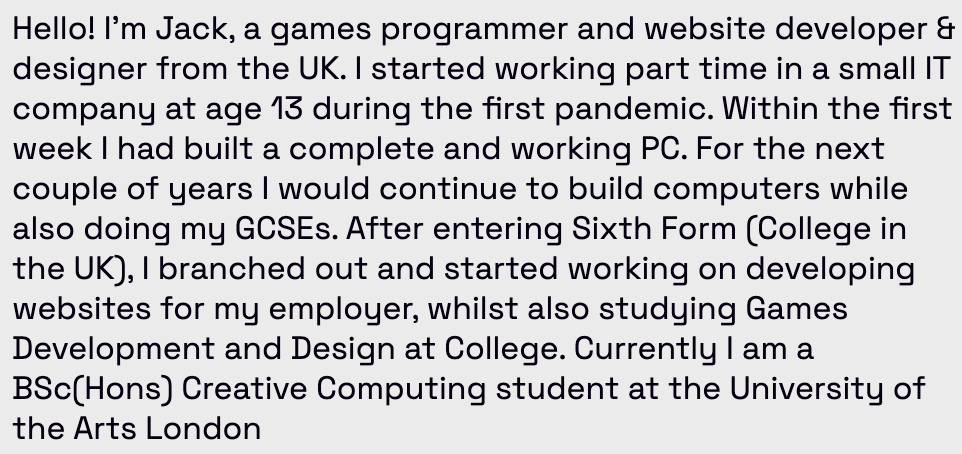
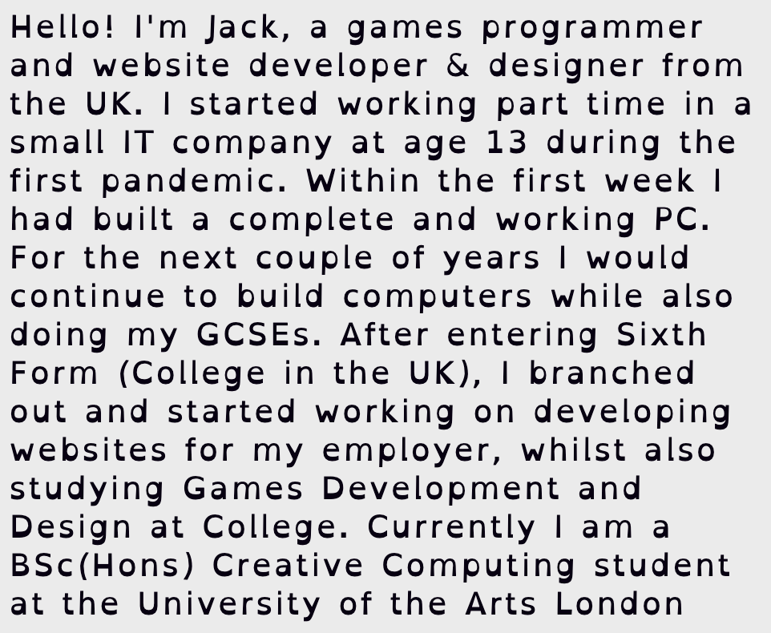

<head>
    
</head>

<a class="indexButton" href="#index">To Index</a>
<h1>Coding Three: Web Development Studio</h1>
<h2 id="index">Index</h2>
<ul>
    <li><a href = "#ub">Unit Brief</a></li>
    <li><a href = "#w01">Week 01</a></li>
    <li><a href = "#w02">Week 02</a></li>
    <li><a href = "#w03">Week 03</a></li>
    <li><a href = "#w04">Week 04</a></li>
    <li><a href = "#w05">Week 05</a></li>
    <li><a href = "#w06">Week 06</a></li>
    <li><a href = "#w07">Week 07</a></li>
    <li><a href = "#w08">Week 08</a></li>
    <li><a href = "#w09">Week 09</a></li>
    <li><a href = "#w10">Week 10</a></li>
    <li><a href = "#w11">Week 11</a></li>
</ul>
<h2 id="ub">Unit Brief</h2>

    In this unit, you'll dive into the basics of web development. In a field which has a new set of
    popular tools every three to six months, it’s critical to lay a proper foundation for quickly
    onboarding emerging techniques. You will learn HTML, CSS, and continue with JavaScript.
    The emerging and popular methods for using CSS and JavaScript on modern website will
    be explored and discussed. Integrating into a simple database, you will learn how to
    connect front end presentations with server-side applications. Animations in the DOM using
    JavaScript and CSS will be covered. In conjunction with technical skills, you will learn
    popular user experience design patterns and discuss considerations for accessible design.

<h2 id="w01">Week 01</h2>
<a href="https://moodle.arts.ac.uk/course/section.php?id=595120#:~:text=accessible%20text%20formatting.-,Task,-(weekly%20task)%3A%C2%A0">Link to task</a>

    Make a copy of the task from Hr 2. Make at least 1 new version of it and make the text easy to read according to the guidelines from resources below. Think about:
    font size,
    colours and contrast
    line length
    line spacing
    semantic structure: include at least section, 2 header levels, paragraph tags.
      
    Add an image to the page and ensure to add alt text.
      
    In the documentation, include ~200 words on: 
    screenshots of the different page versions
    a description of what you did
    a reflection on how the accessibility & readability of your page changed.

 

    For this week, I chose to combine both of the hour 2 task options, by creating a calligram of an emoji style icon from an extract of an intro about myself. 
      
    For the accessible version of the part of the assignment, this is the before:

    This is the after:

If you are unable to view the images, these are the following changes:

    <ul>
        <li>Background from white to an off-white</li>
        <li>Text is now dark grey instead of black</li>
        <li>Increased the line height of text</li>
        <li>Increased the size of text</li>
        <li>Increased the letter spacing</li>
        <li>Changed the font</li>
    </ul>

    The goal of all this is was to make the text more defined and easier to read for the visually imapared an dyslexic.
      
    The reason for changing the background and text colour is actually a personal. Because I spend so much time on devices, when I work on custom websites I make the background an off white, which is gentler on my eyes. I also take away the harshness of the black text by lightening it just a fraction.
      
    For the font styling, I decided to increase the line height, to help with characters which go below the text line, i.e. pqyj, etc. The incease in text size was to make the text stand out a bit more and be more visable to those with impared vision. For the same reason, I increased the word spacing and letter spacing, in order to make each charater and word more defined
      
    Finally, when I was browsing the internet for dyslexic friendly fonts, the primary reccomended was called Open Dyslexia. The reasoning given is that the font was made in such a way that it would catch the reader's eye on a specific part of each letter.
       

<h3>Reflection on the readability of the text</h3>

    Putting the calligram aside, the text should tick every tick box for accessable text. The text is decently spaced; nothing overlaps and words are distinct. The font is widely agreed to be the most accessible for visually imapred and dyslexic readers. The background colour and text colour have a high enough contrast, meaning the text is distinct from the background.

<h2 id="w02">Week 02</h2>
<a href="https://moodle.arts.ac.uk/course/section.php?id=595121#module-1656380:~:text=A%20/%20Pastoral%20Support-,Weekly%20Task,-Task%3A%20Use%20hyperlinks">Link to task</a>

    Task: Use hyperlinks in a creative/artistic context
    
    Create a mini-website that uses hyperlinks in an artistic way. Think about how we can use hyperlinks as a tool for expression. For example:
    
    redirects in an infinite loop, 
    write a poem using hyperlinks, or create an archive for resources,
    an interactive text-based / RPG game,
    a non-linear novel or story,
    a mini compendium of knowledge on a selected topic.
    feel free to explore more creative potentials of hyperlinks. 

  
For this week, I chose to make a maze using hyperlinks. You would start on the <a href="week02.html">week02.html</a> page, with the goal of reaching the exit.
  

Orignially I had no idea how to use hyperlinks cretively. It's never been something that's come up when I have been working on pojects in the past. After a while I did come up with the idea of using small web pages to create a maze like game.

<h2 id="w03">Week 03</h2>
<h2 id="w04">Week 04</h2>
<h2 id="w05">Week 05</h2>
<h2 id="w06">Week 06</h2>
<h2 id="w07">Week 07</h2>
<h2 id="w08">Week 08</h2>
<h2 id="w09">Week 09</h2>
<h2 id="w10">Week 10</h2>
<h2 id="w11">Week 11</h2>
